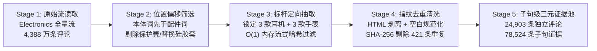

# 基于用户评论的需求识别与可解释产品选择辅助系统 — 项目说明文档
> **项目制作者**：周衍 3240103297  
> **课程名称**：《设计大数据基础》课程大作业  
> **数据来源**：[Amazon Reviews'23 (`Electronics`)](https://amazon-reviews-2023.github.io/)（数据快照截至 2023 年 9 月）  
> **核心理念**：从千万级真实用户评论中提取**“特征—场景—情绪”子句级三元证据**，量化人群需求分歧与硬件故障信号，通过**零代码配置驱动实现从单一品类（无线耳机）向跨品类（智能手表）无缝迁移**，并构建**顶层直观呈现、底层默认折叠溯源**的可解释产品选择辅助系统。

---
## Demo
https://design-bigdata-project-reviewlens-dgkcturnxv46mubbsn5fbl.streamlit.app/

---
## 目录

1. [系统实机演示视频](#1-系统实机演示视频)
2. [研究背景与核心痛点](#2-研究背景与核心痛点)
3. [五级可复现数据集构建漏斗](#3-五级可复现数据集构建漏斗)
4. [核心算法（五步闭环与三元组抽取实例）](#4-核心算法五步闭环与三元组抽取实例)
5. [模块化引擎核心代码解析](#5-模块化引擎核心代码解析)
6. [实验结果：需求分歧、盲标评估与跨品类迁移](#6-实验结果需求分歧盲标评估与跨品类迁移)
7. [可解释产品选择辅助系统原型](#7-可解释产品选择辅助系统原型)
8. [项目目录结构与文件清单](#8-项目目录结构与文件清单)
9. [快速启动与全流程复现命令](#9-快速启动与全流程复现命令)
10. [总结、学术边界声明与未来展望](#10-总结学术边界声明与未来展望)

---

## 1. 系统实机演示视频

本项目包含一段完整的**系统实机交互录屏演示视频**（视频文件为根目录下的 `ReviewLens-40s-1080p60.mp4`），1080P 60fps 规格，时长约 40 秒，涵盖以下核心交互流程：

- **场景直达**：点击高频场景胶囊标签（如“🏃 跑步健身防掉”或“🔋 续航与充电”），或在底部输入框输入自然语言需求；
- **直观优选**：即时输出“🏆 综合口碑优选”横幅与直观的好评率水平进度条；
- **渐进式折叠溯源**：点击展开底层折叠面板，核查英文评论原句、[评论 ID] 与 Wilson 95% 置信区间；
- **零代码跨品类迁移**：顶部一键切换至“⌚ 智能手表”，商品卡片与评测指标无缝变形重构。

> 💡 **在线观看与本地查看**：在 GitHub 上可直接点击根目录下的 [`ReviewLens-40s-1080p60.mp4`](ReviewLens-40s-1080p60.mp4) 播放，或在本地通过任意媒体播放器打开浏览。

---

## 2. 研究背景与核心痛点

在消费电子产品选购与工业设计需求洞察中，传统电商平台评分与通用大模型推荐存在三大显著盲区：

1. **电商评分“J 型双峰极化”掩盖真实场景短板**  
   实证统计表明，目标耳机评论中 **5 星好评占 57.5%（13,558 条）**，**1 星差评占 13.7%（3,234 条）**，呈现典型的“J 型双峰极化分布”。单一的总体星级均分（如 `4.3 / 5.0`）完全掩盖了用户在高频细分场景下（如“跑步狂甩会不会掉”、“地铁通勤降噪够不够用”、“戴眼镜睡觉压不压耳”）的真实体验分化。
2. **复合转折长句导致跨维度情感串扰**  
   真实用户评论中大量包含 `but / however / although / yet` 等转折复合句（例如前半句称赞运动耳挂稳固，后半句抱怨两个月后单耳断充）。传统的整句关键词匹配或“无极性词时用总星级回退（Rating Fallback）”策略，极易把好评错误张冠李戴给故障维度，造成严重的情感串扰。
3. **通用大模型推荐缺乏统计置信度与原句溯源**  
   直接向未受控的通用 LLM 询问选购建议时，模型往往依赖预训练先验参数复述官方宣传卖点，既缺乏基于大样本评论的正负比例与统计置信区间支撑，也无法提供可回溯核查的真实用户评论原句。

---

## 3. 五级可复现数据集构建漏斗

本项目基于 UCSD McAuley Lab 发布的 **Amazon Reviews'23 (`Electronics`)** 原始流，设计了五级可复现数据提纯漏斗：



### 双品类标杆产品矩阵与数据规模

| 品类定位 | 产品名称 | ASIN 编号 | 产品形态与设计定位 | 原始行数 | 去重后独立评论数 | 提取子句三元证据数 |
| :--- | :--- | :--- | :--- | :---: | :---: | :---: |
| **主验证池：无线耳机** | **Beats Powerbeats Pro** | `B07R5QD598` | 耳挂式专业运动旗舰 | 11,488 | 11,226 | 37,510 |
| **主验证池：无线耳机** | **Beats Studio Buds** | `B096SV8SJG` | 入耳式主动降噪（ANC）通勤耳机 | 7,561 | 7,417 | 21,671 |
| **主验证池：无线耳机** | **TOZO A1 Mini** | `B09FT58QQP` | 超轻量化平价迷你半入耳耳机 | 4,959 | 4,949 | 15,223 |
| *无线耳机小计* | *3 款跨形态耳机* | — | *覆盖运动耳挂 / 降噪入耳 / 轻量迷你* | *24,008* | ***23,592*** | ***74,404*** |
| **跨品类池：智能手表** | **Samsung Galaxy Watch 4** | `B096BKNB5F` | 全功能 WearOS 智能生态旗舰手表 | 668 | 661 | 2,000 |
| **跨品类池：智能手表** | **Amazfit Bip U Pro** | `B08M5K65GF` | 轻量化长续航高性价比运动手表 | 424 | 421 | 1,246 |
| **跨品类池：智能手表** | **Garmin Venu Sq Music** | `B08G5B2YZP` | 专业户外运动心率与离线音乐手表 | 232 | 229 | 874 |
| *智能手表小计* | *3 款跨定位手表* | — | *覆盖智能生态 / 长续航轻便 / 专业运动* | *1,324* | ***1,311*** | ***4,120*** |
| **双品类总计** | **6 款标杆产品** | — | **双品类多形态对照矩阵** | **25,332** | **24,903** | **78,524** |

---

## 4. 核心算法（五步闭环与三元组抽取实例）

本项目严格遵循开题设计的 **「1. 收集 $\rightarrow$ 2. 清洗 $\rightarrow$ 3. 标注 $\rightarrow$ 4. 分歧 $\rightarrow$ 5. 呈现」** 五步闭环框架：

### 4.1 五步算法设计全景表

| 步骤 | 阶段目标 | 核心落地算法与数学机制 | 对应代码模块 |
| :---: | :--- | :--- | :--- |
| **1. 收集** | 获取三款耳机（及跨品类手表）的用户评论数据 | • **位置偏移启发式本体筛选**：$\text{pos}(\text{core\_term}) < \text{pos}(\text{acc\_term})$ 过滤配件<br/>• **标杆本体定向全量抽取**：突破宽泛抽样稀疏瓶颈<br/>• **$O(1)$ 内存 Gzip 流式哈希过滤**：单遍扫描 `4,388 万`行 JSONL | `scripts/extract_earbuds_data.py`<br/>`scripts/extract_smartwatch_data.py` |
| **2. 清洗** | 去重、缺失值处理、配件过滤与抽样复核 | • **HTML 剥离与空白规范化**：正则清除残留标签，合并 `title + text`<br/>• **SHA-256 确定性指纹去重**：按 $\text{SHA256}(\text{pid}\parallel\text{uid}\parallel\text{ts}\parallel\text{text})$ 剔除重复<br/>• **分层随机抽样复核**：固定 `seed=42`，按正/负/待定分层各抽 30 条（共 90 条） | `review_engine/core.py`<br/>`review_engine/sample.py` |
| **3. 标注** | 提取“特征—场景—情绪”三元组 `<Aspect, Scene, Sentiment>` | • **两级转折子句偏移切分**：先按句末标点切分，再按 `\b(but\|however\|although\|yet\|while)\b` 二次切分，严格维护 `text[start:end]`<br/>• **70 字符最小距离情感唯一归属**：多维度共现时计算 $a^* = \arg\min_a d(w, a)$，仅当 $d(w, a^*) \le 70$ 时赋极性，结合前 3 词元否定词翻转<br/>• **无星级回退 + 二阶段质量归因**：无显式情感词严标 `unknown`；负面子句经 TF-IDF + Logistic 回归剥离硬件缺陷与主观偏好 | `review_engine/core.py`<br/>`scripts/run_advanced_analysis.py` |
| **4. 分歧** | 比较正负比例与不同场景的需求差异 | • **去锚词稀疏 TF-IDF + MiniBatchKMeans 聚类**：动态屏蔽维度锚词构建 `1-2 gram` TF-IDF，聚类 40 个耳机子话题簇与 32 个手表子话题簇<br/>• **评论级 Mixed 剥离与 Wilson 区间**：同一评论内同单元正负并存记为 `mixed`；计算平滑好评率与 Wilson 95% 置信区间 $[L, U]$<br/>• **极化需求冲突分数**：量化人群争议强度 | `review_engine/core.py`<br/>`review_engine/aspect_topics.py` |
| **5. 呈现** | 输出选择卡与可追溯证据片段 | • **五层异构证据图谱**：构建 `Product -> Aspect -> Scene -> Subtopic -> Clause` 有向证据网<br/>• **双语意图扩展 + 子线性 TF-IDF 余弦检索**：中文提问映射并扩展英文锚词，计算 $\cos(\mathbf{q}, \mathbf{d})$ 召回 Top-$K$ 原句<br/>• **双模 RAG + 渐进式折叠选择卡**：本地确定性引擎 + DeepSeek 双模生成，顶层展示好评进度条，底层默认折叠原句证据 | `agent.py`<br/>`demo.py` |

### 4.2 “特征—场景—情绪”三元组抽取实例

以一条典型的复合转折用户评论为例：

> **原始评论**：`"I wear these at the gym and the earhooks stay secure, however the battery stopped charging after 2 months."`

算法首先识别转折连词 `however`，将原句切分为两个带精确字符偏移的子句，并在各自子句内部独立完成三元组抽取，彻底消除跨子句情感串扰：

- **三元组 ①（转折前子句 `offset 0:54`）**：
  - **特征 (`Aspect`)**：佩戴稳定（匹配锚词 `earhooks`）
  - **场景 (`Scene`)**：运动（匹配场景词 `gym`）
  - **情绪 (`Sentiment`)**：`Positive (+)`（观点词 `secure` 距离 `earhooks` 为 $d=14 \le 70$ 字符，前 3 词元无否定词）
- **三元组 ②（转折后子句 `offset 63:109`）**：
  - **特征 (`Aspect`)**：续航与充电（匹配锚词 `battery`）
  - **场景 (`Scene`)**：`General`（子句内无显式场景限定词）
  - **情绪 (`Sentiment`)**：`Negative (-)`（匹配负面词 `stopped charging`，并命中硬件质量故障词典 `issue_flag = True`）

---

## 5. 模块化引擎核心代码解析

项目核心引擎 [`review_engine/core.py`](review_engine/core.py) 仅用 **105 行高内聚 Python 代码** 实现了配置与算法的完全解耦：

### ① 转折子句切分与原文字符偏移追踪 (`clauses`)
```python
def clauses(text):
    for sent in re.finditer(r'[^.!?;:\n]+[.!?;:\n]*', text):
        s, base, last = sent.group(0), sent.start(), 0
        for m in re.finditer(r'\b(?:but|however|although|though|yet|while)\b', s, re.I):
            if s[last:m.start()].strip():
                yield from _trim(s, last, m.start(), base)
            last = m.start()
        if s[last:].strip():
            yield from _trim(s, last, len(s), base)  # 严格保证 text[start:end] == clause_text
```

### ② 70 字符最近邻情感归属与前 3 词元否定翻转 (`extract`)
```python
for sign, lexicon in ((1, config['positive']), (-1, config['negative'])):
    for term, pos in _hits(clause, lexicon):
        distances = {a: min(abs(pos - p) for _, p in h) for a, h in aspects.items()}
        name = min(distances, key=distances.get)
        if distances[name] <= 70:
            prior = re.findall(r"[a-z']+", clause[:pos].lower())[-3:]
            if any(t in config['negations'] for t in prior): sign = -sign
            scores[name] += sign
label = 'positive' if s > 0 else 'negative' if s < 0 else 'unknown'
```

### ③ 评论级去重、Wilson 95% 置信区间与冲突度聚合 (`wilson` & `aggregate`)
```python
for (p, a, c), groups in sorted(by_cell.items()):
    labels = ['mixed' if {'positive', 'negative'} <= s else
              'positive' if 'positive' in s else 'negative' if 'negative' in s else 'unknown'
              for s in groups.values()]
    pos, neg, mix, unk = (labels.count(k) for k in ('positive', 'negative', 'mixed', 'unknown'))
    n = pos + neg
    lo, hi = wilson(pos, n)  # z=1.96 样本量自适应 95% 置信下界与上界
    score = (2 * min(pos, neg) / n) * min(1.0, math.log1p(n) / math.log1p(100)) if n else 0.0
```

### ④ 去锚词子话题聚类与子线性 TF-IDF 余弦检索 (`retrieve`)
```python
def retrieve(records, query, k=5, **filters):
    pool = [r for r in records if all(not v or r.get(f) == v for f, v in filters.items())]
    vec = TfidfVectorizer(ngram_range=(1, 2), stop_words='english', sublinear_tf=True)
    mat = vec.fit_transform([r['clause_text'] for r in pool])
    sims = (mat @ vec.transform([query]).T).toarray().ravel()
    top_idx = sims.argsort()[::-1][:k]
    return [{**pool[i], 'similarity': round(float(sims[i]), 4)} for i in top_idx]
```

---

## 6. 实验结果：需求分歧、盲标评估与跨品类迁移

### 6.1 高分歧痛点识别与二阶段硬件故障/主观偏好剥离

- **高冲突痛点单元（Conflict Score Top）**：
  - **`Powerbeats Pro × 续航与充电`**：好评率 `57.2%`（Wilson 95% CI `[55.2%, 59.3%]`），冲突度高达 **`0.97`**。子话题聚类揭示：用户高度肯定其单次 9 小时续航，但集中抱怨充电盒金属触点对位不良导致单耳断充（`one side not charging`）。
  - **`Beats Studio Buds × 佩戴稳定（运动场景）`**：好评率 `59.4%`，冲突度 **`0.95`**。无耳翼入耳式结构在日常通勤表现尚可，但在健身房出汗场景下频繁滑落。
  - **`TOZO A1 Mini × 音质表现`**：好评率达 **`84.2%`**，百元价位下用户对其低频表现形成高满意度共识。
- **二阶段负面归因分类器（5 折分层交叉验证 `Macro-F1 = 0.9669`）**：
  - 对全部负面子句训练字符与词级混合 TF-IDF + Logistic 回归二阶段分类器（准确率 `96.81%`，质量故障类 F1 `96.21%`，主观体验类 F1 `97.18%`）。
  - 定量证实：`Powerbeats Pro` 续航充电差评中 **`28.4%`** 属于疑似硬件故障信号（断充、电池早衰），蓝牙连接差评中 **`25.4%`** 属于单耳断连故障；而佩戴舒适度差评 **`100%`** 属于个人耳道/耳廓尺寸的主观适配差异。

### 6.2 90 条分层盲标人工定量评估

通过 `review_engine/sample.py` 从正面、负面、`unknown` 预测桶中各随机抽取 30 条（共 90 条）子句进行独立双盲人工标注，运行 `review_engine/evaluate.py` 得到核心指标：

| 评估维度 | 精确率 (`Precision`) | 召回率 (`Recall`) | `F1-Score` | 样本支持度 / 备注 |
| :--- | :---: | :---: | :---: | :--- |
| **负面情感 (`negative`)** | **96.7%** | 65.9% | 78.4% | 宁漏勿错，极少产生虚假差评警报 |
| **正面情感 (`positive`)** | **90.0%** | 73.0% | 80.6% | 高置信度识别真实正向口碑 |
| **待定/中性 (`unknown`)** | 70.0% | 100.0% | 82.4% | 保守兜底桶，严防星级污染 |
| **加权平均 (`Weighted Avg`)** | **86.9%** | 77.8% | 79.9% | 总体情感分类准确率 `77.8%` |
| **方面抽取准确率 (`Aspect Acc`)** | — | — | **92.2%** | `83 / 90` 准确命中子句核心方面 |
| **场景识别准确率 (`Scene Acc`)** | — | — | **93.3%** | `84 / 90` 准确识别具体使用场景 |

> **系统误差归因**：在全部 21 条不一致样本中，**48%（10 条）** 源于“无显式极性词的事实型抱怨”（例如 `"battery lasts 2 hours"` 或 `"went through three pairs"`）。由于系统严禁使用总星级回退，这类不含显式情绪词的句子被保守归入 `unknown`，从而以牺牲部分召回率为代价，换取了 **90.0%~96.7% 的高极性精确率**。

### 6.3 从无线耳机到智能手表的零代码跨品类迁移

在不修改 `review_engine` 任何一行 Python 源码的前提下，仅编写 `config/smartwatch.json` 词典配置文件，即在数秒内完成了 3 款智能手表（`1,311` 条独立评论 / `4,120` 条子句证据 / `32` 个子话题簇）的完整实证分析：

- **Samsung Galaxy Watch 4 (`661` 条评论)**：屏幕显示与表盘好评率高达 **`88.9%`**，健康心率监测好评率 **`76.3%`**；但**续航充电好评率仅 `35.1%`**（负面占比 `64.9%`，冲突度 `0.87`），精准捕捉到“一天一充”核心痛点。
- **Amazfit Bip U Pro (`421` 条评论)**：**续航充电好评率高达 `86.5%`**，轻便佩戴舒适度 **`86.0%`**；但在蓝牙连接与 App 同步维度存在明显分化（冲突度 `0.96`）。
- **Garmin Venu Sq Music (`229` 条评论)**：运动心率/GPS 监测（好评率 **`77.6%`**）与续航表现（好评率 **`76.8%`**）均衡稳健，但睡眠佩戴场景与触控灵敏度存在一定争议（冲突度 `0.97`）。

---

## 7. 可解释产品选择辅助系统原型

本项目基于 Streamlit 与双模受控 RAG 构建了蓝白学术风格、全界面统一采用 **`Noto Serif Simplified Chinese`（思源宋体）** 排版的交互式选购辅助系统（`demo.py` & `agent.py`）：

1. **双品类无缝切换与高频场景直达**  
   顶部支持「无线耳机 / 智能手表」双品类切换；中部提供等高商品卡片聚焦模式与 4 大高频场景快捷入口（如耳机端的“🚇 地铁通勤降噪”、“🏃 跑步健身防掉”；手表端的“🏃 运动与心率”、“🔋 续航与充电”），底部输入框与上方卡片容器严格对齐。
2. **直观优选结论与可视化好评率进度条**  
   面向普通消费者化繁为简：提问后第一眼直接给出 **“🏆 综合口碑优选”** 横幅，以及各款产品在目标维度上的**好评率可视化进度条**与直观状态标签（`🟢 口碑稳健` / `🟡 体验分化` / `🔴 槽点集中`）。
3. **双模受控 RAG 与渐进式默认折叠溯源**  
   - 支持 **本地确定性模板引擎**（毫秒级响应、零幻觉）与 **DeepSeek 大模型 API 生成**（温度 `0.2`，强制行内标注 `[证据 ID]` 与统计指标）双模式。
   - 底层采用**默认折叠（`expanded=False`）**设计：需要核查依据时，点击展开即可查看支撑结论的**真实英文评论原句、评论 ID、发生场景、Wilson 95% 置信区间以及系统 90 条盲标评估看板**。

---

## 8. 项目目录结构与文件清单

仓库结构已做全面精简与规范化整理，所有代码、配置与数据均采用相对路径解耦：

```text
├── ReviewLens-40s-1080p60.mp4                        # 系统 40 秒实机操作演示视频（1080P 60fps 高清演示）
├── 启动系统.bat                                       # Windows 一键启动脚本（双击直接拉起 Streamlit 交互系统）
├── demo.py                                           # 可解释产品选择辅助系统前端主程序（蓝白风格 + Noto Serif SC 字体）
├── agent.py                                          # 多品类意图解析、子线性 TF-IDF 检索与双模受控 RAG 引擎
├── requirements.txt                                  # Python 依赖包清单
├── LICENSE                                           # 开源许可证 (MIT License)
├── README.md                                         # 项目全景说明文档（与本文档保持同步）
├── 算法设计.md                                       # 核心算法设计说明
├── 汇报PPT大纲提示词.md                               # 汇报 PPT 结构大纲与绘图提示词
├── PPT备注讲稿_5分钟版.md                             # 逐页分段式 5 分钟 PPT 演示者视图备注讲稿
├── 视频生成提示词_40秒版.md                           # 40 秒演示视频生成提示词与中文对照
├── 3240103297_周衍_基于用户评论的需求识别与可解释产品选择辅助系统.pptx  # 汇报 PPTX 文件
│
├── config/                                           # 零硬编码品类词典配置目录
│   ├── earbuds.json                                  # 无线耳机 8 大特征、6 大场景、正负情感词与质量故障词典
│   └── smartwatch.json                               # 智能手表 8 大特征、6 大场景、正负情感词与质量故障词典
│
├── review_engine/                                    # 模块化核心引擎包
│   ├── __init__.py                                   # 模块导出接口
│   ├── core.py                                       # 105 行核心算法（转折切分、70字符最近邻归属、Wilson区间、冲突度与检索）
│   ├── run.py                                        # 端到端数据流提取与统计聚合 CLI 入口
│   ├── aspect_topics.py                              # 去锚词稀疏 TF-IDF + MiniBatchKMeans 细粒度子话题聚类
│   ├── sample.py                                     # 分层随机抽样工具（生成 90 条盲标样本）
│   ├── evaluate.py                                   # 人工盲标混淆矩阵、精确率/召回率/F1 与误差归因评估器
│   └── benchmark.py                                  # V1 基线与 V2 引擎对比评测模块
│
├── data/raw/                                         # 提纯后的双品类原始评论数据与统计清单
│   ├── amazon_target_earbuds_reviews.jsonl           # 3 款无线耳机原始评论流（24,008 行）
│   ├── amazon_target_earbuds_manifest.json           # 无线耳机五级提纯漏斗审计清单
│   ├── amazon_target_smartwatch_reviews.jsonl        # 3 款智能手表原始评论流（1,324 行）
│   └── amazon_target_smartwatch_manifest.json        # 智能手表提纯漏斗审计清单
│
├── outputs/                                          # 全量实验结果、学术图表与 6K 超清 PPT 渲染图
│   ├── engine_v2/                                    # 无线耳机证据表(74,404条)、聚合表、90条盲标评估、质量归因与时序趋势
│   ├── aspect_topics_v2/                             # 无线耳机 40 个去锚词细粒度子话题簇
│   ├── smartwatch_v2/                                # 智能手表跨品类证据表(4,120条)与冲突度聚合表
│   ├── smartwatch_topics_v2/                         # 智能手表 32 个细粒度子话题簇
│   ├── academic_figures/                             # 高分辨率蓝白学术图表（fig01 ~ fig07）
│   └── ppt_slides/                                   # 全套 8 张 6K 超高清 (5760×3240) 汇报幻灯片成品图
│
├── assets/                                           # 产品高清实物图素材（用于系统卡片与 PPT 展示）
│   ├── powerbeats_pro.jpg                            # Beats Powerbeats Pro 实物图
│   ├── studio_buds.jpg                               # Beats Studio Buds 实物图
│   ├── tozo_a1.jpg                                   # TOZO A1 Mini 实物图
│   └── garmin_venu_sq.jpg                            # Garmin Venu Sq Music 实物图
│
├── scripts/                                          # 数据抽取、进阶实验与学术图表自动化渲染脚本
│   ├── extract_target_amazon_reviews.py              # 无线耳机流式抽取脚本
│   ├── extract_smartwatch_reviews.py                 # 智能手表流式抽取脚本
│   ├── run_advanced_analysis.py                      # 90条盲标评估、二阶段质量分类器与季度时序监测脚本
│   └── generate_academic_figures.py                  # 学术报告图表生成脚本
│
└── tests/                                            # 自动化单元测试套件
    └── test_engine.py                                # 5 项核心算法与多品类 Agent 回归测试（全部通过）
```

---

## 9. 快速启动与全流程复现命令

### 9.1 一键启动交互式系统（推荐）

直接双击仓库根目录下的批处理文件：

```bat
启动系统.bat
```

或在终端中执行：

```powershell
python -m streamlit run demo.py
```

浏览器将自动打开 `http://localhost:8501` 进入可解释产品选择辅助系统。

### 9.2 核心流水线与评估复现命令

```powershell
# 1. 运行 5 项核心单元测试（验证子句偏移、否定翻转、多维消歧、Wilson 区间与多品类 Agent）
python -m unittest discover -s tests -v

# 2. 复现无线耳机 V2 子句级三元组抽取（74,404 条子句）与 40 个子话题聚类
python -m review_engine.run --input data/raw/amazon_target_earbuds_reviews.jsonl --config config/earbuds.json --output outputs/engine_v2
python -m review_engine.aspect_topics --evidence outputs/engine_v2/evidence.csv --config config/earbuds.json --output outputs/aspect_topics_v2

# 3. 复现智能手表跨品类零代码迁移验证（4,120 条子句）与 32 个子话题聚类
python -m review_engine.run --input data/raw/amazon_target_smartwatch_reviews.jsonl --config config/smartwatch.json --output outputs/smartwatch_v2
python -m review_engine.aspect_topics --evidence outputs/smartwatch_v2/evidence.csv --config config/smartwatch.json --output outputs/smartwatch_topics_v2

# 4. 复现 90 条盲标评估、二阶段质量缺陷分类器（5折 CV）与季度时序监测
python -m review_engine.evaluate --input outputs/engine_v2/annotation_labeled.csv --output outputs/engine_v2/evaluation.json
python scripts/run_advanced_analysis.py

# 5. 自动化重新生成全套学术图表
python scripts/generate_academic_figures.py
```

---

## 10. 总结、学术边界声明与未来展望

### 10.1 四项核心成果总结
1. **双品类高纯度证据库**：构建覆盖无线耳机与智能手表共 **24,903 条独立评论、78,524 条子句级三元证据** 的结构化数据集。
2. **模块化核心引擎**：以 **105 行零硬编码核心代码** 实现两级转折切分、70 字符最近邻情感归属、评论级去重与冲突度量化，消除跨子句情感串扰。
3. **严谨定量评估与归因**：90 条盲标评估负面精确率达 **`96.7%`**、正面精确率 **`90.0%`**、方面/场景准确率 **`92.2% / 93.3%`**；二阶段质量分类器 `Macro-F1 = 0.9669`。
4. **可解释交互系统原型**：实现双品类切换、双模受控 RAG 与渐进式默认折叠原句溯源。

### 10.2 方法论解释边界声明
- **数据时效与幸存者偏差边界**：当前数据快照截至 **2023 年 9 月**；评论中的正负比例与质量风险占比仅反映**已发表评论中的体验提及分布**，不能直接等同于产品的客观声学物理指标或真实硬件返修率。

### 10.3 未来深化与拓展方向
1. **拓展多品类有效电商评论数据库**：基于零代码 JSON 配置机制，进一步拓展至更多消费电子与日常家居品类，接入多平台数据源，构建高覆盖率、持续更新的**有效电商评论数据库**。
2. **融合轻量预训练模型提升隐式抱怨召回**：针对无显式情感词的事实型抱怨（如 `"battery lasts 2 hours"`），引入轻量级 `DeBERTa-v3` 对 `unknown` 子句做二阶段极性重排序，兼顾高精确率与高召回率。
3. **跨代际产品演进与多模态评论融合**：结合用户评论实拍附图与长周期季度时间序列，自动追踪产品跨代际迭代（如一代 vs 二代机型）在核心分歧痛点上的工程改进成效。
